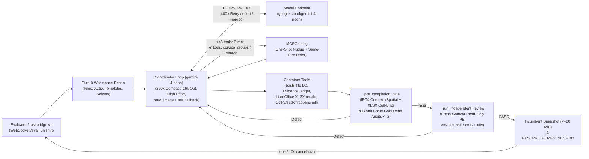
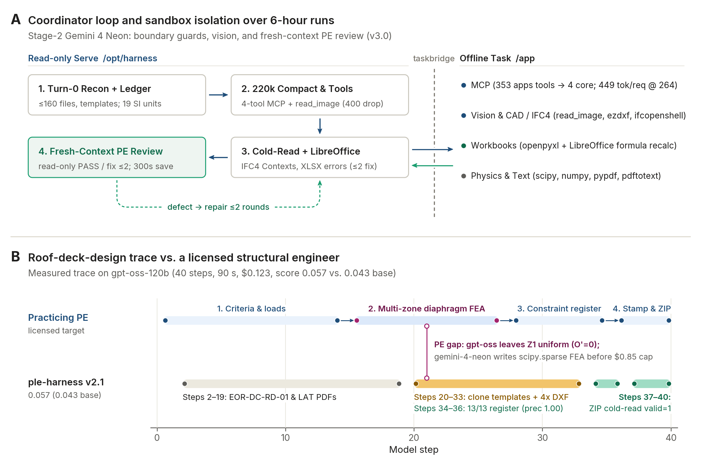
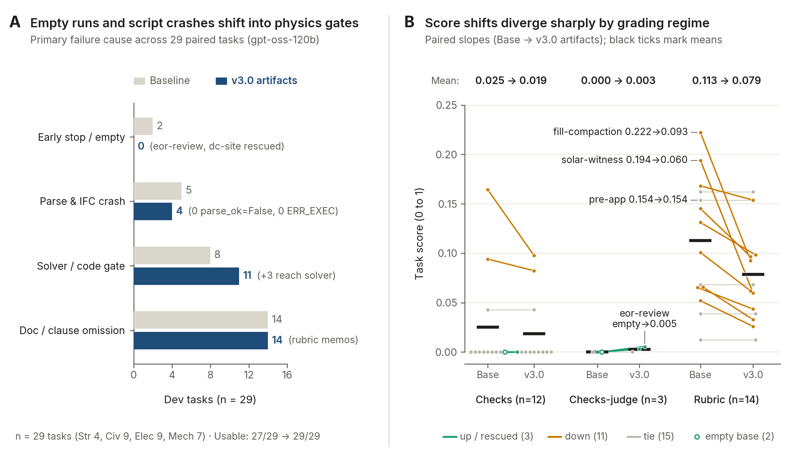
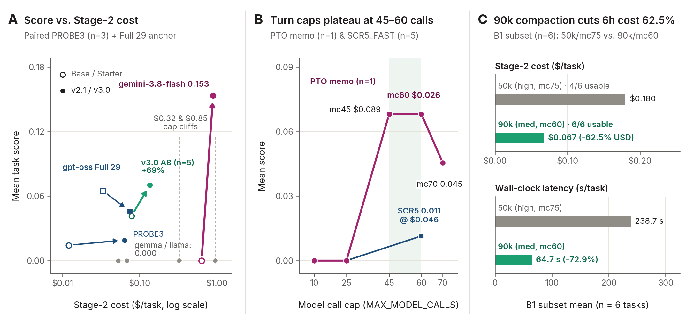

# PLE Engineering Coordinator (`ple-harness`)

[](LICENSE)
[](submission.yaml)
[](taskbridge.py)
[](#verified-checks--reproducibility)
[](artifacts/manifest.json)

**Deterministic gate-survival agent harness for Google's [Physical-Engineering's Last Exam (PLE)](https://ple-bench.com/).**

Most agent harnesses treat engineering failures as model reasoning deficits—assuming that shell access, eager tool schemas, and aggressive `50k` compaction suffice. Across 29 public dev tasks under locked Stage-2 `google-cloud/gpt-oss-120b` pricing (`$0.09/$0.36` per 1M tokens; `deepseek/deepseek-v4.1-flash` local judge), paired runs contradict that assumption: a capped starter baseline (`0.065`, `$0.033/task`, `1.09 min/task`) drops `2/29` tasks empty (`27/29` usable), breaks Excel parsers (`parse_ok=False`), crashes IFC4 scripts (`ERR_EXEC`), collapses on 353-tool MCP portals, and thrashes under `50k` compaction.

`ple-harness` v3.0 ([`serve.py`](serve.py) + [`harness.py`](harness.py)) eliminates empty exports (**`29/29` usable**) and all parse/script crashes, fixes Cluster-A blind-MCP collapse (`0.015 -> 0.118`), and lifts `google-cloud/gemini-3.8-flash` on `PROBE3` from **`0.000` (`0/3`) to `0.153` (`3/3`)**. On our targeted 5-task A/B slice, removing v2.1's non-MCP-turn write blocking, adding LibreOffice formula recalculation, tightening IFC4/XLSX cold-read audits, and inserting a fresh-context PE reviewer lifted `gpt-oss-120b` **`+69.1%` relative to v2.1 (`0.042 -> 0.070`)**, bringing the 29-task artifact snapshot to **`0.046` (`$0.075/task`, `1.70 min/task`, `29/29` usable)**. For Stage 2, [`submission.yaml`](submission.yaml) upgrades to **`google-cloud/gemini-4-neon`** (`high`, `220k` compaction, `16k` output, `300s` verify reserve, vision enabled, independent PE reviewer enabled, uncapped calls/USD); as disclosed below, the committed [`artifacts/`](artifacts/manifest.json) bundle was generated locally on `gpt-oss-120b` (`deepseek/deepseek-v4.1-flash` judge) prior to switching `model_api` to `gemini-4-neon`.

---

## Architecture Overview (v3.0)





### Safeguards & Implementation Symbols

| Failure Mode Targeted | `ple-harness` v3.0 Mechanism | Key Symbols |
|---|---|---|
| **Early stops & empty exports (`2 -> 0`)** | Turn-0 `_workspace_recon()` (`<=160` files, `<=5` XLSX schemas, solvers), milestone nudges (`ENABLE_MILESTONE_GUARD`), and missing-deliverable checks in `_pre_completion_gate` | [`harness.py`](harness.py): `_workspace_recon`, `_milestone_note`, `_pre_completion_gate` |
| **353-tool MCP bloat & turn starvation** | Direct `<server>__<tool>` when `<=8` tools; `-99.28%` 4-tool `ondemand` catalog (`62,370 -> 449 tok/req` on 264 tools) with `service_groups()` counts & inline schemas (`<=8` hits); v3.0 keeps same-batch deferral while firing zero-MCP and post-MCP nudges once (`_mcp_nudge_fired`, `_post_mcp_write_nudge_fired`) instead of blocking non-MCP prose turns | [`mcp_catalog.py`](mcp_catalog.py): `MCPCatalog`, `service_groups`, `search_tools`, `ONDEMAND_CORE_TOOLS`; [`harness.py`](harness.py): `EngineeringCoordinator.run` |
| **Unit flips & revision conflicts** | `EvidenceLedger` normalizes `19` physical dimensions to SI (`tr`, `btuh`, `mbh`, `in_wg`, `ft_h2o`, `klf`, `pcf`, `kcmil`, `c*cm/w`, etc.) and gates unresolved `supersedes` conflicts | [`evidence.py`](evidence.py): `EvidenceLedger`, `UNIT_TABLE`, `normalize_unit`, `convert_unit` |
| **Broken templates, IFC4, DXF, PDF & memos** | Cold-read auditing plus LibreOffice `.xlsx` formula evaluation (`_recalc_workbook_if_needed`), IFC4 `missing_representation_contexts` & `missing_spatial_structure`, per-cell `excel_formula_error`, and `blank_template_sheet` checks (`MAX_VERIFY_REPAIRS="2"`) | [`harness.py`](harness.py): `_recalc_workbook_if_needed`; [`verifiers/`](verifiers/__init__.py): `audit_workbook_bytes`, `audit_ifc4_bytes`, `audit_dxf_bytes`, `audit_pdf_bytes`, `audit_decision_memo` |
| **Unreviewed stubs & blind image docs** | Fresh-context read-only PE reviewer (`_run_independent_review`, `<=2` rounds, `<=12` calls) before final pass, plus `read_image` visual tool with automatic `drop_image_input()` fallback on endpoints rejecting image parts | [`harness.py`](harness.py): `_run_independent_review`, `drop_image_input`, `ENABLE_IMAGE_INPUT` |
| **50k thrashing, timeout & API errors** | Model-aware compaction (`220k` on 1M-context Gemini 4 Neon / `90k` otherwise) retaining `12` recent outputs, `20 MiB` incumbent rollback, `RESERVE_VERIFY_SEC="300"`, `CancelledError` `_last_durable_summary` rescue, empty-string `merged()` thought-signature guard, and `400` recovery (`drop_effort`, `drop_stream_options`) | [`harness.py`](harness.py): `compact_at`, `compact`, `finish`, `_snapshot_incumbent`, `merged`, `marked`, `drop_thinking`, `drop_effort`, `drop_stream_options`; [`pricing.py`](pricing.py): `UsageTracker`, `LOCKED_RATES` |

---

## Measured Dev-Set Results (29 Public Dev Tasks)

Local evaluations ran via an OpenAI-compatible HTTP proxy against OpenRouter (`MODEL_PROXY_URL` via `--env-file openrouter.env`) under locked Stage-2 token pricing ([`pricing.py`](pricing.py): `gpt-oss-120b` `$0.09/$0.36`, `gemini-4-neon` `$3.00/$15.00/$0.15` cached) with `JUDGE_MODEL=deepseek/deepseek-v4.1-flash`. After validating the v3.0 artifacts on `gpt-oss-120b`, [`submission.yaml`](submission.yaml) was upgraded to `google-cloud/gemini-4-neon` for Stage-2 execution.



### 1. Paired 29-Task Progression (`gpt-oss-120b`)

| Metric / Slice | Starter Baseline (`base`) | `ple-harness` v2.1 (`29/29`) | `ple-harness` v3.0 Artifacts (`24 v2.1 + 5 v3.0 AB`) |
|---|---:|---:|---:|
| **Overall Dev Mean (29 tasks)** | `0.065` (`27/29` usable, `2` empty) | `0.041` (`29/29` usable) | **`0.046`** (**`29/29` usable, `0` empty**) |
| **Mean Stage-2 Cost & Runtime** | `$0.033/task` · `1.09 min` (`65.2 s`) | `$0.065/task` · `1.58 min` (`95.0 s`) | `$0.075/task` · `1.70 min` (`102.3 s`) |
| **Structural (`n=4`)** | `0.034` (`3/4` usable) | **`0.036`** (`4/4` usable) | `0.033` (`4/4` usable; `roof-deck` recall `0.148`) |
| **Civil (`n=9`)** | `0.097` (`8/9` usable) | `0.052` (`9/9` usable) | `0.061` (`9/9` usable; `fill-compaction` `10x` vs. v2.1) |
| **Electrical (`n=9`)** | `0.065` (`9/9` usable) | `0.041` (`9/9` usable) | `0.047` (`9/9` usable; `pre-application` `0.154`) |
| **Mechanical (`n=7`)** | `0.040` (`7/7` usable) | `0.029` (`7/7` usable) | `0.033` (`7/7` usable; `fire-solve` `+60%` vs. v2.1) |
| **Grading: `checks` (`12`) / `checks-judge` (`3`) / `rubric` (`14`)** | `0.025` / `0.000` / `0.113` | `0.020` / **`0.003`** / `0.067` | `0.019` / **`0.003`** / **`0.079`** (`+17%` rubric recovery) |

### 2. Controlled Ablations (Subset-Scoped, Zero Extrapolation)

| Ablation Config (Scope) | Mean Score | Usable | Stage-2 $/task | Mean Runtime |
|---|---:|---:|---:|---:|
| **`v3.0 A/B` (5 targeted tasks): Starter Baseline** | `0.104` | `5/5` | `$0.028` | `70.0 s` |
| **`v3.0 A/B` (5 targeted tasks): `ple-harness` v2.1** | `0.042` | `5/5` | `$0.078` | `95.8 s` |
| **`v3.0 A/B` (5 targeted tasks): `ple-harness` v3.0 (`+69.1%` vs. v2.1)** | **`0.070`** | **`5/5`** | `$0.136` | `138.2 s` |
| `SCR5_FAST` (5 checks tasks): Baseline / `+MCP` / `+Recon` / `Full v2.1` | `0.009` / `0.006` / `0.009` / **`0.011`** | `4/5` / `5/5` / `4/5` / **`5/5`** | `$0.008` / `$0.043` / `$0.037` / `$0.046` | `25.6` / `61.4` / `56.2` / `56.0 s` |
| `B1` (6 tasks): Baseline (`90k`, `med`, `mc60`) | `0.023` | `5/6` | `$0.022` | `33.0 s` |
| `B1` (6 tasks): v2.1 (`50k` compact, `high`, `mc75`) | `0.024` | `4/6` | `$0.180` | `238.7 s` |
| `B1` (6 tasks): v2.1 (`90k` compact, `med`, `mc60`) | `0.023` | **`6/6`** | `$0.067` (`-62.5%`) | `64.7 s` (`-72.9%`) |
| Cluster A: v2 Blind MCP (`4` Elec) -> v2.1 Indexed (`high`, `mc45`, `3` Elec) | `0.015` -> **`0.118`** | `4/4` -> `3/3` | `$0.062` -> `$0.099` | `143.5 s` -> `178.0 s` |
| `permission-to-operate-memo`: `mc10` / `mc25` / `mc45_high` / `mc60_med` / `mc70` | `0.000` / `0.000` / **`0.068`** / **`0.068`** / `0.045` | `1/1` each | `$0.009` / `$0.040` / `$0.089` / **`$0.026`** / `$0.054` | `45` / `91` / `197` / `120` / `108 s` |

Key `v3.0 A/B` task shifts (`gpt-oss-120b`, `med`, `90k`, `mc60`, `MAX_REVIEW_ROUNDS=1`, `REVIEWER_MAX_CALLS=6`): `fill-compaction-acceptance` jumped `10x` (`0.009 -> 0.093`), `pre-application-capacity-response` rose `+50%` (`0.103 -> 0.154`), `fire-solve-convergence` rose `+60%` (`0.039 -> 0.062`), `roof-deck-design` expanded register coverage (`13/13 -> 17/17`, `register_recall_hard` `0.111 -> 0.148`, all `6` workbook sheets populated, `0.043`), and on `data-hall-mep-routing` the harness emitted valid `IfcProject` + `IfcGeometricRepresentationContext` passing `ifcopenshell.open` while the fresh-context PE reviewer independently caught the `1,422 B` stub produced because `gpt-oss-120b` (`ENABLE_IMAGE_INPUT=false` in that sweep) could not read the 7 raster architectural PNGs—motivating `ENABLE_IMAGE_INPUT="true"` + `google-cloud/gemini-4-neon` in [`submission.yaml`](submission.yaml).



### 3. Cross-Model Generalizability

Prompt caching (`82–94%` across `PROBE3`; `89.6%` on 29-task v3.0 artifacts) and Turn-0 schemas benefit every tool-compliant model, whereas repair loops and FEA synthesis selectively unlock frontier reasoners—and tight spend caps (`$0.32`/`$0.85`) induce discontinuous `0.000` cliffs mid-solve:

| model_api | Baseline | Yours | Delta | Tokens in/out/cached | $/task |
|---|---:|---:|---:|---:|---:|
| `google-cloud/gpt-oss-120b` (`v3.0 Artifacts`, 29) | `0.065 (27/29)` | `0.046 (29/29)` | `-0.019 (+2 usable)` | `790k/9.6k/708k` *(Base: 347k/5.9k/244k)* | `$0.033 -> $0.075` |
| `google-cloud/gpt-oss-120b` (`v3.0 A/B`, n=5 vs. v2.1) | `0.104 (5/5)` | **`0.070 (5/5)`** | **`+69.1% vs. v2.1 (0.042)`** | `v3.0 A/B (v2.1->v3.0)` | `$0.078 -> $0.136` |
| `google-cloud/gpt-oss-120b` (`PROBE3`, n=3) | `0.014 (3/3)` | `0.019 (3/3)` | `+0.005` | `682k/5.6k/642k` *(Base: 107k/6.6k/83k)* | `$0.012 -> $0.063` |
| `google-cloud/gemini-3.8-flash` (`PROBE3`, n=3) | `0.000 (0/3)` | **`0.153 (3/3)`** | **`+0.153 (+3 usable)`** | `1.63M/35.1k/1.34M` *(Base: 1.15M/20.2k/923k)* | `$0.634 -> $0.894` |
| `google-cloud/gemini-3.8-flash` (`roof`, n=1, `$0.32` cap) | `—` | `0.000 (0/1)` | `cap cliff` | `788k/7.3k/675k` | `$0.326` (cap hit) |
| `google-cloud/gemma-4-26b` (`PROBE3`, n=3) | `0.000 (1/3)` | `0.000 (1/3)` | `0.000 (-29.5% s)` | `1.43M/21.8k/1.29M` *(Base: 1.67M/26.2k/1.46M)* | `$0.069 -> $0.052` |
| `google-cloud/llama-4-maverick` (`PROBE3`, n=3) | `0.000 (0/3)` | `0.000 (0/3)` | `0.000 (tool fail)` | `154k/12.1k/126k` *(Base: 4.2k/1.7k/0.3k)* | `$0.003 -> $0.068` |
| `google-cloud/gemini-4-neon` (`roof`, n=1, `$0.85` cap) | `—` | `0.000 (0/1)` | `cap cliff (FEA)` | `622k/29.2k/473k` | `$0.957` (cap hit) |

---

## Verified Checks & Reproducibility

### Automated Tests (`40 passed, 0 failed`)

```bash
uv run --with pytest --with-requirements requirements.txt python -m pytest -q
# -> 40 passed, 7 warnings (upstream ezdxf PyparsingDeprecationWarning)
```

| Test Module | Tests | Coverage |
|---|---:|---|
| [`tests/test_cad_pdf_synthetic.py`](tests/test_cad_pdf_synthetic.py) | `5` | DXF `latin-1` decode, `NaN`/degenerate entities, PDF placeholders/blank pages, `_run_audit_internal` wiring |
| [`tests/test_decision_memo_synthetic.py`](tests/test_decision_memo_synthetic.py) | `3` | `DOCX`/`MD` PTO prerequisite flips, work-package mismatches, future effective-date checks |
| [`tests/test_geometry_ifc_synthetic.py`](tests/test_geometry_ifc_synthetic.py) | `4` | 2D viewport similarity, STEP IFC4 cross/self clashes, forbidden zones, translation invariance, `RepresentationContexts` & spatial hierarchy |
| [`tests/test_mcp_efficiency_synthetic.py`](tests/test_mcp_efficiency_synthetic.py) | `2` | 264-tool HTTP MCP benchmark (`62,370 -> 449 tok/req`, `-99.28%`, `264/264` reachable) & `<=8` direct routing |
| [`tests/test_mv_workbook_synthetic.py`](tests/test_mv_workbook_synthetic.py) | `8` | Workbook & ZIP audit, circular reference detection, formula evaluation, per-cell formula error coords, blank template sheet detection, incumbent rollback, `EvidenceLedger` SI conversions |
| [`tests/test_protocol_e2e.py`](tests/test_protocol_e2e.py) | `18` | Live `serve.py` WebSocket loop: `429`/`500` retries, `400` fallbacks, budget cap, `cancel`, one-shot MCP nudges, fresh-context PE reviewer, `drop_image_input` 400 fallback, recon, `service_groups` |

### Competition Kit Validation & OpenRouter Local Proxy

Run from a checkout of [`google-research/ple`](https://github.com/google-research/ple) against `git -C ../ple-harness rev-parse HEAD` (set `DOCKER_DEFAULT_PLATFORM=linux/amd64` on Apple Silicon per Thread `#761085`):

```bash
export DOCKER_DEFAULT_PLATFORM=linux/amd64

# 1. Validate submission manifest (Stage-2 target: google-cloud/gemini-4-neon)
uv run python -m kit validate ../ple-harness

# 2. Full container build, egress proxy, live smoke & live MCP check (no --no-smoke)
uv run python -m kit check ../ple-harness --env-file openrouter.env

# 3. Verify unpacked 29-task dev artifacts
uv run python -m kit artifacts ../ple-harness

# 4. Run full 29-task dev evaluation (requires HF gated dataset token)
export HF_TOKEN=<your_hf_read_token>
uv run python eval/run.py ../ple-harness --env-file openrouter.env
```

---

## Repository Layout & Configuration

- [`submission.yaml`](submission.yaml) — Container build/serve manifest (`model_api: google-cloud/gemini-4-neon`) and Stage-2 v3.0 environment flags.
- [`serve.py`](serve.py) — Thin WebSocket entrypoint invoking `taskbridge.run(solve)`.
- [`harness.py`](harness.py) — `EngineeringCoordinator`, `RuntimeConfig`, Turn-0 recon, `220k`/`90k` compaction, one-shot MCP nudges, `read_image` + `400` fallback, LibreOffice formula recalc, `_pre_completion_gate`, `_run_independent_review`, and timeout/cancel/incumbent recovery.
- [`mcp_catalog.py`](mcp_catalog.py) — Adaptive Streamable-HTTP `MCPCatalog` (`direct` fast-path `<=8` tools; `service_groups()`-indexed 4-tool `ondemand` catalog with inline search schemas above `8` tools).
- [`evidence.py`](evidence.py) — `EvidenceLedger` (`19` canonical SI dimensions, `supersedes` conflict resolution).
- [`verifiers/`](verifiers/__init__.py) — Cold-read binary auditors ([`workbook_audit.py`](verifiers/workbook_audit.py), [`geometry_ifc_audit.py`](verifiers/geometry_ifc_audit.py), [`decision_memo_audit.py`](verifiers/decision_memo_audit.py), [`cad_pdf_audit.py`](verifiers/cad_pdf_audit.py)).
- [`pricing.py`](pricing.py) — Locked Kaggle Stage-2 model pricing (`LOCKED_RATES`, `#761530`) and `UsageTracker`.
- [`taskbridge.py`](taskbridge.py) — Upstream `google-research/ple` WebSocket/MCP protocol relay (`Apache-2.0`).
- [`artifacts/`](artifacts/manifest.json) — Unpacked 29-task dev deliverables (`29/29` usable, generated locally on `gpt-oss-120b`).
- [`tests/`](tests/) — `40` synthetic and live WebSocket E2E tests.

### `submission.yaml` `env` Settings (Stage-2 v3.0 Defaults)

| Variable | Value | Effect |
|---|---:|---|
| `COMPACT_AT_TOKENS` | `"220000"` | Context threshold triggering trimming & `SUMMARY_PROMPT` compaction (`220k` on 1M-context models; `90k` otherwise) |
| `MAX_OUTPUT_TOKENS` | `"16384"` | Max completion tokens per LLM call (auto-shrunk on `400` context errors) |
| `MAX_MODEL_CALLS` | `"0"` | Uncapped model calls inside the 6-hour Stage-2 container (`"0"` = unlimited) |
| `REASONING_EFFORT` | `"high"` | Frontier reasoning level (auto-stepped down or dropped on `400`) |
| `RESERVE_VERIFY_SEC` | `"300"` | Wall-clock margin reserved before timeout for audit, PE review & `finish()` |
| `BUDGET_CAP_USD` | `"0"` | Uncapped Stage-2 spend (`"0"` disables per-task USD cutoff cliffs) |
| `MCP_DISCOVERY_MODE` | `"ondemand"` | `"ondemand"` (adaptive/indexed) vs. `"eager"` |
| `MCP_DIRECT_MAX_TOOLS` | `"8"` | Max connected MCP tools exposed directly before switching to 4-tool indexed discovery |
| `ENABLE_EVIDENCE_LEDGER` | `"true"` | Enables `record_evidence`, `query_evidence`, `convert_units`, and conflict gating |
| `ENABLE_EXPORT_VERIFIER` | `"true"` | Enables `run_export_audit`, LibreOffice XLSX recalc, and `_pre_completion_gate` |
| `ENABLE_INCUMBENT_RETENTION` | `"true"` | Enables `save_incumbent` / `restore_incumbent` (`20 MiB` cap) rollback |
| `ENABLE_MILESTONE_GUARD` | `"true"` | Injects periodic reminders when 0 target deliverables exist on disk |
| `ENABLE_WORKSPACE_RECON` | `"true"` | Runs Turn-0 read-only file, XLSX template schema, and solver inventory |
| `ENABLE_IMAGE_INPUT` | `"true"` | Enables `read_image` visual inspection with auto-fallback on `400` unsupported endpoints |
| `ENABLE_INDEPENDENT_REVIEWER` | `"true"` | Enables fresh-context read-only PE reviewer (`_run_independent_review`) |
| `MAX_VERIFY_REPAIRS` | `"2"` | Max automated repair turns triggered by `_pre_completion_gate` |
| `MAX_REVIEW_ROUNDS` | `"2"` | Max independent PE review-and-repair rounds |
| `REVIEWER_MAX_CALLS` | `"12"` | Tool-call cap per fresh-context PE review round |

---

## License & Attribution

- **License**: Software is licensed under **[Apache-2.0](LICENSE)**; documentation under **CC BY 4.0**.
- **Upstream Attribution**: [`taskbridge.py`](taskbridge.py) and streaming, thought-signature, prompt-caching, and compaction primitives are adapted with attribution from [`google-research/ple`](https://github.com/google-research/ple) (`Apache-2.0`, upstream commit `5cf736f8b6e6f28eea71cae52de0c3bedaa88fa2`).
