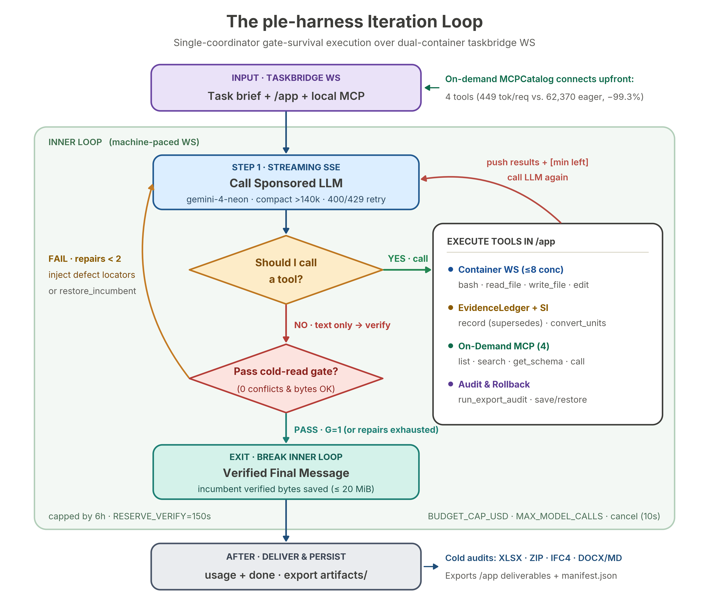
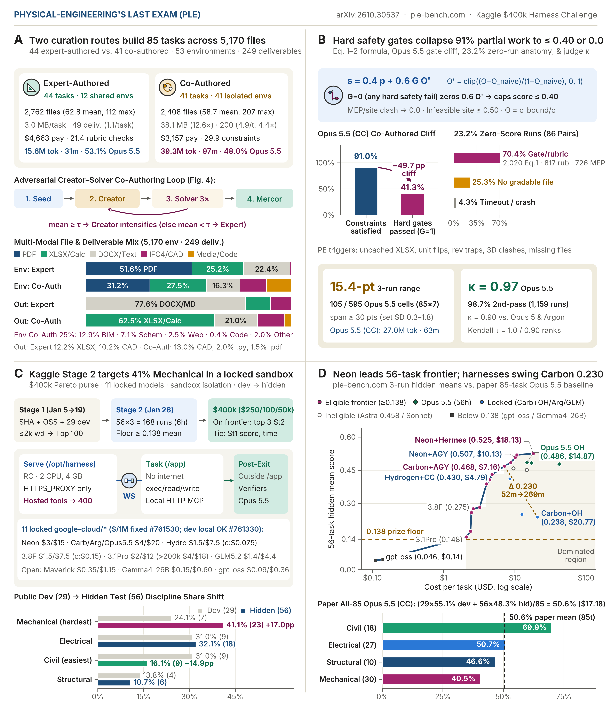
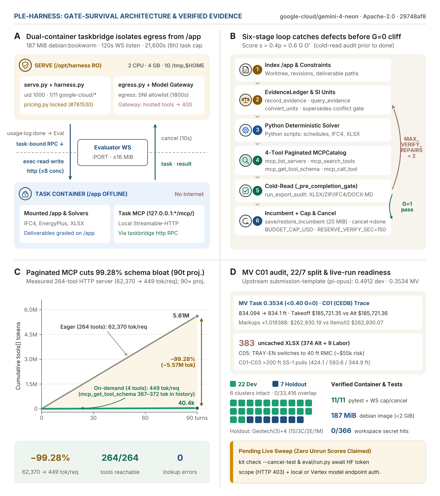

# PLE Engineering Coordinator (`ple-harness`)

[](LICENSE)
[](submission.yaml)
[](taskbridge.py)
[](#verified-evidence--test-matrix)

**Deterministic gate-survival agent harness for Google's [Physical-Engineering's Last Exam (PLE)](https://ple-bench.com/).**

`ple-harness` pairs a single-coordinator WebSocket execution loop ([`serve.py`](serve.py) + [`harness.py`](harness.py)) with four modular engineering safeguards designed to survive PLE's all-or-nothing physical, unit, and deliverable-integrity gates: **adaptive MCP discovery** (direct fast-path for small catalogs, `-99.28%` paginated discovery for 264-tool world servers), **sequential MCP/read-before-write deferral**, a **unit-aware `EvidenceLedger`**, and **deterministic cold-read export auditors** across `XLSX`, `ZIP`, `IFC4` STEP, `DOCX`/`MD`, `DXF`, and `PDF`.

<p align="center">
  
</p>
<p align="center"><em>Figure 1. Single-coordinator gate-survival execution loop over the dual-container <code>taskbridge</code> WebSocket boundary.</em></p>

---

## Why Frontier Agents Fail on PLE (and How `ple-harness` Targets Each Gate)

In [`arXiv:2610.30537`](https://arxiv.org/abs/2610.30537), constraint-and-objective engineering tasks score each deliverable item as:

$$s = 0.4\,p + 0.6\,G\,O'$$

where $p \in [0, 1]$ is the fraction of constraints met and $G \in \{0, 1\}$ collapses to $0$ if **any single hard safety or physical feasibility constraint fails**—capping the item at $0.40$ (and `0.0` outright on hard 3D MEP clashes or missing deliverables). As shown in Figure 2:

- **The `G = 1` Hard-Gate Cliff**: Across audited `Claude Opus 5.5` runs on co-authored tasks, agents satisfied **`91.0%`** of individual constraints yet cleared every hard gate ($G = 1$) on only **`41.3%`** of items. Among zero-score runs, **`70.4%`** failed constraints or rubrics despite writing files, **`25.3%`** produced no gradable deliverable, and **`4.3%`** timed out or crashed.
- **Massive Harness Variance (`0.230` spread)**: On identical weights (`Gemini 4 Carbon`, 56 hidden tasks), `ple-bench.com` 3-run means swing by **`0.230` points** (`0.238` @ `$20.77` / `269 min` in `openhands` vs. `0.468` @ `$7.16` / `52 min` in `agy`).
- **Dev-to-Hidden Domain Shift**: Mechanical engineering expands from **`24.1%`** of Public Dev (`7/29`) to **`41.1%`** of Hidden Test (`23/56`)—the hardest discipline (`40.5%` paper Opus 5.5 mean vs. `69.9%` Civil)—amplifying 3D BIM/CAD (`IFC4`, `DXF`) and HVAC/unit accuracy risks.

<p align="center">
  
</p>
<p align="center"><em>Figure 2. PLE benchmark anatomy (<code>arXiv:2610.30537</code>), <code>G=0</code> failure cliff, Kaggle Stage 2 locked sandbox &amp; Dev-to-Hidden discipline shift, and 56-task hidden Pareto frontier.</em></p>

### Gate-Targeted Harness Controls

| Failure Mode on PLE | `ple-harness` Mechanism | Key Implementation Symbols |
|---|---|---|
| **264-tool MCP schema bloat** (`62,370 tok/req`) vs. **1-tool MCP discovery overhead** | Adaptive `MCPCatalog`: exposes `<server>__<tool>` schemas directly when `total <= MCP_DIRECT_MAX_TOOLS` (`"8"`), and switches automatically to 4 constant-size paginated tools (`449 tok/req`, `-99.28%`) above threshold | [`mcp_catalog.py`](mcp_catalog.py): `MCPCatalog`, `ONDEMAND_CORE_TOOLS`, `estimate_schema_tokens` |
| **Hallucinated / premature file writes** before MCP or file observation | Sequential MCP-before-write deferral in `EngineeringCoordinator.run()` defers same-batch or pre-MCP `write_file`/`edit_file` calls (`deferred: inspect the MCP result...`) + `_wrote_after_mcp` check in `_pre_completion_gate` | [`harness.py`](harness.py): `EngineeringCoordinator`, `_pre_completion_gate`, `SYSTEM_PROMPT` |
| **Silent unit flips & stale drawing/spec revisions** | Task-scoped `EvidenceLedger` normalizing 19 physical dimensions to SI (`tr`, `btuh`, `mbh`, `mmbtu/hr`, `hp`, `in_wg`, `ft_h2o`, `klf`, `pcf`, `kva`/`mva`, `mcm`/`kcmil`, `c*cm/w`, etc.), flagging conflicts until resolved via `supersedes`, and formatting `summary_markdown()` | [`evidence.py`](evidence.py): `EvidenceLedger`, `UNIT_TABLE`, `normalize_unit`, `convert_unit` |
| **Uncached XLSX formulas, 3D MEP clashes, broken CAD/PDF/memos** (`G=0`) | `_pre_completion_gate` re-reads saved bytes via `session.read_file` and runs cold-read auditors across `.xlsx`/`.xlsm`, `.zip`, `.ifc`, `.docx`/`.md`, `.dxf`, and `.pdf` (triggering up to `MAX_VERIFY_REPAIRS="2"` repair turns) | [`verifiers/`](verifiers/__init__.py): `audit_workbook_bytes` (`_CircularReferenceError`, `SUM`/`AVERAGE`/`MIN`/`MAX`/`COUNT`/`ROUND`), `audit_zip_deliverables`, `audit_ifc4_bytes`, `calibrate_viewport_2d`, `audit_decision_memo`, `audit_dxf_bytes`, `audit_pdf_bytes` |
| **Destructive late edits, budget runaways, `cancel` truncation** | In-memory verified deliverable rollback (`MAX_INCUMBENT_BYTES = 20 MiB`), locked `#761530` USD tracking (`BUDGET_CAP_USD`), `MAX_MODEL_CALLS`, `RESERVE_VERIFY_SEC="150"`, and durable `final_message` rescue on `asyncio.CancelledError` | [`harness.py`](harness.py): `_snapshot_incumbent`, `restore_incumbent`; [`pricing.py`](pricing.py): `UsageTracker`, `LOCKED_RATES`, `call_cost_usd` |
| **Cross-family Stage-2 API incompatibilities** (`400` errors, cache misses) | Gemini 4 thought-signature preservation (`extra_content.google.thought_signature`, no `thinkingBudget`), Claude Opus 5.5 `marked()` (`<= 2` `ephemeral` cache breakpoints, no forbidden sampling/budget params), Responses fallback, and live `400` recovery (`drop_thinking`, `drop_effort`, `drop_stream_options`, `use_max_tokens`, `shrink_output`, `_as_bool`) | [`harness.py`](harness.py): `marked`, `drop_thinking`, `drop_effort`, `drop_stream_options`, `_as_bool` |

<p align="center">
  
</p>
<p align="center"><em>Figure 3. Dual-container <code>taskbridge</code> isolation, six-stage verification loop, 90-turn MCP schema projection, and baseline MV C01 audit (snapshot from commit <code>29748af8</code> prior to the adaptive fast-path, MCP deferral guard, and DXF/PDF verifier expansion documented below).</em></p>

---

## Verified Evidence & Test Matrix

> [!IMPORTANT]
> **Strict Empirical Honesty**: Every build, unit test, protocol check, and container check below was executed and verified directly on the current hardened codebase. **Live 29-task `eval/run.py` dev sweeps and `artifacts/` export have NOT been run yet** because local dataset pull awaits gated Hugging Face (`google/physical-engineerings-last-exam`) read-token scope alignment (`HTTP 403`) and inference endpoint keys; **zero unrun dev scores are claimed.**

### 1. Post-Upgrade Automated Suite (`24 passed, 0 failed, 0 skipped`)

Executed from repository root via `uv run --with pytest --with-requirements requirements.txt python -m pytest -q` (`24 passed, 7 warnings in 14.08s`; all 7 warnings are upstream `ezdxf.queryparser` `PyparsingDeprecationWarning`):

| Test Suite | Tests | Verified Guarantees |
|---|---:|---|
| [`tests/test_cad_pdf_synthetic.py`](tests/test_cad_pdf_synthetic.py) | `5` | Clean DXF & `latin-1` decode, empty modelspace, missing layers/text, `NaN` coords, zero-span degenerate entities; PDF `min_pages`, `TODO`/`TBD`/`FIXME`/`[INSERT`/`#REF!`/`#VALUE!`/`#DIV/0!`/`#NAME?` placeholder leaks, blank-page defect vs. image-only warning, and `EngineeringCoordinator._run_audit_internal` wiring |
| [`tests/test_mv_workbook_synthetic.py`](tests/test_mv_workbook_synthetic.py) | `5` | Clean MV workbook & ZIP audit; missing `C07`, `#REF!`, uncached formulas, `Takeoff -> Alternatives` skew, narrative drift; incumbent rollback; nested `SUM`/`AVERAGE`/`MIN`/`MAX`/`COUNT`/`ROUND` + `_CircularReferenceError`; new HVAC/structural/electrical unit conversions & `EvidenceLedger.summary_markdown()` |
| [`tests/test_geometry_ifc_synthetic.py`](tests/test_geometry_ifc_synthetic.py) | `3` | 2D viewport similarity calibration + held-out residual gate; STEP IFC4 cross-service clash, corner self-clash, forbidden zone, BFS reachability, and rigid translation invariance (`+125.0, -47.5, +18.25`) |
| [`tests/test_decision_memo_synthetic.py`](tests/test_decision_memo_synthetic.py) | `3` | Clean `DOCX`/`MD` PTO decision memo; single `PR-03` prerequisite flip (`NOT_APPROVED_PENDING`) & MCP work-package mismatch while holding `PR-01`/`PR-02`/`PR-04` invariant; empty memo & future effective date block |
| [`tests/test_mcp_efficiency_synthetic.py`](tests/test_mcp_efficiency_synthetic.py) | `2` | Live 264-tool HTTP MCP server: `62,370 -> 449` schema tokens/req (`-99.28%`, `264/264` reachable, `0` lookup errors); `MCPCatalog(direct_threshold=8)` direct `<server>__<tool>` routing at `1` and `8` tools vs. automatic 4-tool `ondemand` switch at `9` tools |
| [`tests/test_protocol_e2e.py`](tests/test_protocol_e2e.py) | `6` | Live `serve.py` WebSocket process: `429`/`500` retries, `400` `max_completion_tokens`/`reasoning_effort` & `stream_options` fallback, `BUDGET_CAP_USD="0.05"` hard stop, `MAX_MODEL_CALLS` wrapup, mid-stream `cancel` recovery, parallel MCP+write deferral E2E, and `marked()` (`<= 2` breakpoints) / Gemini `thought_signature` compliance |

### 2. Clean-Container `kit check --rebuild --cancel-test` Across Two Local Models

Verified on `linux/amd64` (`colima`, `DOCKER_DEFAULT_PLATFORM=linux/amd64`) against a local Ollama OpenAI-compatible server (`http://localhost:8090/v1`), inspecting `check.json` and `mcp.json` directly:

| Model (`openai-compatible/*`) | Build (`bundle`) | `model` | `listen` | `smoke` | `mcp` (Critical Gate) | `cancel` (`<10s`) | Observed Harness Behavior |
|---|---|---:|---:|---|---|---|---|
| **`qwen3:8b`** (`REASONING_EFFORT: "none"`) | `[PASS]` `193 MiB` (`42s`) | `[PASS]` `13.8s` | `[PASS]` `4s` | `[PASS]` `12s` (`2` reqs, `6,206` in / `199` out) | **`[PASS]` `10s`** (`5` reqs, `4,689` in / `102` out, `4` `http` + `1` `write_file`, `0` malformed, `MCP-281D22DB`) | `[PASS]` | Direct fast-path exposed `apps__secret_word`, waited for observation, wrote exact `MCP-281D22DB` |
| **`llama3.1:8b`** (no `REASONING_EFFORT` set) | `[PASS]` `193 MiB` (`43s`) | `[PASS]` `0.5s` | `[PASS]` `4s` | `[PASS]` `4s` (`1` req, `1,993` in / `52` out) | **`[PASS]` `17s`** (`5` reqs, `9,534` in / `160` out, `4` `http` + `1` `write_file`, `0` malformed, `MCP-B517AC26`) | `[PASS]` | Live `drop_effort` recovered from `does not support thinking` 400; guard deferred 3 premature `write_file` calls until `apps__secret_word` ran; `_as_bool` normalized `append="False"` |

Restored Stage-2 config (`google-cloud/gemini-4-neon`) passes `uv run python -m kit validate` (`ok: ple-harness, google-cloud/gemini-4-neon (Gemini 4 Neon); egress none`). Secret hygiene scan found `0` credential hits and `0` `.env` files in the repository.

### 3. Upstream `mv-conveyance-study` Forensic Audit & Leakage-Safe `22/7` Split

- **Independent `mv-conveyance-study` C01 Audit**: Inspecting the **pre-baked upstream `submission-template` (`pi-opus`, `claude-opus-5-5`, run `b96-r1`)** deliverable (`0.353437` task reward; `0.491242` 29-dev mean)—which is **not** a `ple-harness` run—verified route geometry (`834.0940 -> 834.1 ft` matching `Alternatives!E2` and `Items!H2`) and `23`-row `C01`/`CEDB` takeoff sums (`$185,721.35` vs. `$185,721.36` in `Alternatives`, `$262,930.19` recomputed markup cascade vs. `$262,930.07` in `Items!I2`). Running `audit_workbook_bytes(..., require_cached_formulas=True)` deterministically caught **`383` uncached formula cells** (`374` in `Alternatives` starting `R2C11`, `9` in `LaborRates`) alongside the upstream run's self-reported `C05` mixed `TRAY-EN`/`RMC` (`40 ft`) and `C01`–`C03` `>200 ft` SS-1 feeder pull risks (`424.1`, `593.6`, `344.9 ft`).
- **Zero-Overlap `22/7` Dev/Holdout Split**: Pairwise Jaccard checks across all **`33,416` files** in `google/physical-engineerings-last-exam` (`b3857a3f`) partition the `29` dev tasks into **`22` Development / `7` Frozen Holdout** with **`0` shared corpus overlap** (`Geotech` Cluster C `[3]` + `4` standalone: `1` Structural, `3` Civil, `2` Electrical, `1` Mechanical; `2 checks / 2 checks-judge / 3 rubric`), keeping all 6 project clusters intact.

---

## Repository Layout

- [`submission.yaml`](submission.yaml) — Container build/serve manifest (`name: ple-harness`, `model_api: google-cloud/gemini-4-neon`) and runtime feature flags.
- [`serve.py`](serve.py) — Thin WebSocket entrypoint invoking `taskbridge.run(solve)`.
- [`harness.py`](harness.py) — `EngineeringCoordinator`, `RuntimeConfig`, cross-family API adapters (`marked`, `drop_thinking`, `drop_effort`, `drop_stream_options`), sequential MCP deferral, `_pre_completion_gate`, and incumbent/cancel recovery.
- [`mcp_catalog.py`](mcp_catalog.py) — Adaptive Streamable-HTTP `MCPCatalog` (`direct` fast-path `<= MCP_DIRECT_MAX_TOOLS` vs. 4-tool `ondemand` paginated discovery vs. `eager`).
- [`evidence.py`](evidence.py) — `EvidenceLedger`, physical `UNIT_TABLE` (`19` canonical dimensions), conflict tracking (`supersedes`), and `summary_markdown()`.
- [`verifiers/`](verifiers/__init__.py) — Deterministic cold-read auditors: [`workbook_audit.py`](verifiers/workbook_audit.py), [`geometry_ifc_audit.py`](verifiers/geometry_ifc_audit.py), [`decision_memo_audit.py`](verifiers/decision_memo_audit.py), and [`cad_pdf_audit.py`](verifiers/cad_pdf_audit.py).
- [`pricing.py`](pricing.py) — Locked Kaggle Stage-2 pricing (`LOCKED_RATES`, `#761530`) and `UsageTracker`.
- [`taskbridge.py`](taskbridge.py) — Upstream `google-research/ple` WebSocket & MCP protocol client (`Apache-2.0`).
- [`tests/`](tests/) — `24` synthetic and live WebSocket E2E tests (`test_cad_pdf_synthetic.py`, `test_decision_memo_synthetic.py`, `test_geometry_ifc_synthetic.py`, `test_mcp_efficiency_synthetic.py`, `test_mv_workbook_synthetic.py`, `test_protocol_e2e.py`).

---

## Quickstart & Reproduction

```bash
# 1. Run all 24 unit, verifier, MCP efficiency, and live WebSocket E2E tests
uv run --with pytest --with-requirements requirements.txt python -m pytest -q

# 2. Validate submission manifest from a checkout of google-research/ple
export DOCKER_DEFAULT_PLATFORM=linux/amd64   # Required on Apple Silicon (Thread #761085)
uv run python -m kit validate ../ple-harness

# 3. Clean-container smoke, MCP, and cancel checks (requires Docker + local.env)
uv run python -m kit check ../ple-harness --rebuild --cancel-test --env-file local.env

# 4. Run the 29 public dev tasks and export artifacts/ (after agreeing to HF gated dataset terms)
export HF_TOKEN=<your_hf_read_token>
uv run python eval/run.py ../ple-harness --env-file local.env
```

---

## Configuration Reference (`submission.yaml` `env` Toggles)

All overrides in [`submission.yaml`](submission.yaml) are passed as quoted strings:

| Variable | Default | Options / Format | Effect |
|---|---|---|---|
| `COMPACT_AT_TOKENS` | `"140000"` | Positive integer | Token threshold triggering structured context compaction (`SUMMARY_PROMPT`) |
| `MAX_OUTPUT_TOKENS` | `"32000"` | Positive integer | Initial max completion tokens per LLM call (auto-shrunk on `400` cap errors) |
| `MAX_MODEL_CALLS` | `"0"` | `"0"` (unlimited) or integer | Hard cap on LLM calls before graceful wrapup (`finish`) |
| `RESERVE_VERIFY_SEC` | `"150"` | Seconds | Reserved wall-clock margin prior to `agent_timeout_sec` to finalize safely |
| `BUDGET_CAP_USD` | `"0"` | `"0"` (unlimited) or USD float | Hard per-task USD spend cap enforced via `UsageTracker` (`pricing.py`) |
| `MCP_DISCOVERY_MODE` | `"ondemand"` | `"ondemand"` \| `"eager"` | Selects paginated/adaptive discovery vs. eager schema loading |
| `MCP_DIRECT_MAX_TOOLS` | `"8"` | Non-negative integer | Max connected MCP tools exposed directly as `<server>__<tool>` in `ondemand` mode (`"0"` forces 4 core tools always) |
| `ENABLE_EVIDENCE_LEDGER` | `"true"` | `"true"` \| `"false"` | Enables `record_evidence`, `query_evidence`, `convert_units`, and conflict gating |
| `ENABLE_EXPORT_VERIFIER` | `"true"` | `"true"` \| `"false"` | Enables `run_export_audit` tool and automatic `_pre_completion_gate` cold-read audit |
| `ENABLE_INCUMBENT_RETENTION` | `"true"` | `"true"` \| `"false"` | Enables `save_incumbent` / `restore_incumbent` (`20 MiB` cap) rollback protection |
| `ENABLE_IMAGE_INPUT` | `"false"` | `"true"` \| `"false"` | Enables `inspect_image` multimodal crop loading |
| `MAX_VERIFY_REPAIRS` | `"2"` | Non-negative integer | Max automatic repair loops triggered by `_pre_completion_gate` failures |

---

## Locked Stage-2 Model & Pricing Reference (`#761530`)

Implemented verbatim in [`pricing.py`](pricing.py) (`LOCKED_RATES`) per Kaggle Topic `#761530` (`$/1M` tokens; Stage 2 Pareto costs are permanently fixed to these rates):

| `model_api` | Model | Input (`$/1M`) | Output (`$/1M`) | Cached Input (`$/1M`) | Notes |
|---|---|---:|---:|---:|---|
| `google-cloud/gemini-4-neon` | Gemini 4 Neon | `$3.00` | `$15.00` | `$0.15` | **Configured Stage-2 target** in `submission.yaml` |
| `google-cloud/gemini-4-carbon` | Gemini 4 Carbon | `$4.00` | `$20.00` | `$0.20` | Gemini 4 family (`high` reasoning default) |
| `google-cloud/gemini-4-hydrogen` | Gemini 4 Hydrogen | `$1.50` | `$7.50` | `$0.075` | High-efficiency value contender |
| `google-cloud/gemini-4-argon` | Gemini 4 Argon | `$4.00` | `$20.00` | `$0.20` | Supports `low`/`medium`/`high` `reasoning_effort` |
| `google-cloud/gemini-3.8-flash` | Gemini 3.8 Flash | `$1.50` | `$7.50` | `$0.15` | Fast mid-cost tier |
| `google-cloud/gemini-3.1-pro-preview` | Gemini 3.1 Pro (Preview) | `$2.00` | `$12.00` | `$0.20` | `>200K` prompt tier: `$4.00` / `$18.00` / `$0.40` |
| `google-cloud/claude-opus-5-5` | Claude Opus 5.5 | `$4.00` | `$20.00` | `$0.20` | Cross-family target (`max` effort, `ephemeral` cache marks) |
| `google-cloud/glm-5.2` | GLM 5.2 | `$1.40` | `$4.40` | `$0.14` | Open-weight (`max` effort default) |
| `google-cloud/gemma-4-26b` | Gemma 4 26B A4B | `$0.15` | `$0.60` | `$0.015` | Low-cost open-weight |
| `google-cloud/gpt-oss-120b` | gpt-oss 120B | `$0.09` | `$0.36` | N/A | Lowest-cost open-weight |
| `google-cloud/llama-4-maverick` | Llama 4 Maverick 17B 128E | `$0.35` | `$1.15` | N/A | Open-weight |

---

## License & Attribution

- **License**: Software is licensed under the **[Apache License 2.0](LICENSE)** (`Apache-2.0`). Documentation and figures are licensed under `CC BY 4.0`.
- **Upstream Attribution**: Includes [`taskbridge.py`](taskbridge.py) and streaming, thought-signature, prompt-caching, and compaction primitives adapted with attribution from [`google-research/ple`](https://github.com/google-research/ple) (`Apache-2.0`, upstream commit `5cf736f8b6e6f28eea71cae52de0c3bedaa88fa2`, `sample_submissions/custom-openai`).
