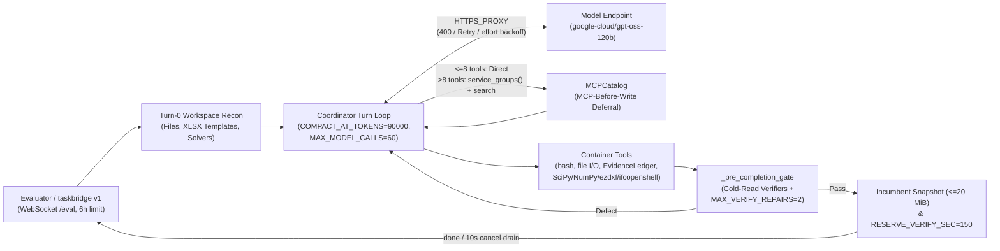

# PLE Engineering Coordinator (`ple-harness`)

[](LICENSE)
[](submission.yaml)
[](taskbridge.py)
[](#verified-checks--reproducibility)
[](artifacts/manifest.json)

**Deterministic gate-survival agent harness for Google's [Physical-Engineering's Last Exam (PLE)](https://ple-bench.com/).**

Most agent harnesses treat engineering failures as model reasoning deficits—assuming that shell access, eager tool schemas, and aggressive `50k` compaction suffice. Across 29 public dev tasks under locked Stage-2 `google-cloud/gpt-oss-120b` pricing (`$0.09/$0.36` per 1M tokens; `deepseek/deepseek-v4.1-flash` local judge), paired runs contradict that assumption: a competent starter baseline (`0.065`, `$0.033/task`, `1.1 min/task`) still drops `2/29` tasks empty (`27/29` usable), breaks Excel parsers (`parse_ok=False`), crashes IFC4 scripts (`ERR_EXEC`), collapses on 353-tool MCP portals, and thrashes under `50k` compaction.

`ple-harness` ([`serve.py`](serve.py) + [`harness.py`](harness.py)) eliminates empty exports (**`29/29` usable**) and all parse/script crashes, fixes Cluster-A blind-MCP collapse (`0.015->0.118`), and lifts `google-cloud/gemini-3.8-flash` on `PROBE3` from **`0.000` (`0/3`) to `0.153` (`3/3`)**, while exposing an honest turn-budget inversion on `gpt-oss-120b` (`0.065->0.041`, `$0.065/task`, `1.6 min/task`) where `mc60` MCP-first gates protect structural exports at the expense of rubric-memo drafting turns (`0.113->0.067`).

---

## Architecture Overview



### Safeguards & Implementation Symbols

| Failure Mode Targeted | `ple-harness` Mechanism | Key Symbols |
|---|---|---|
| **Early stops & empty exports (`2->0`)** | Turn-0 `_workspace_recon()` (`<=160` files, `<=5` XLSX schemas, solvers), milestone nudges (`ENABLE_MILESTONE_GUARD`), and missing-deliverable checks in `_pre_completion_gate` | [`harness.py`](harness.py): `_workspace_recon`, `_milestone_note`, `_pre_completion_gate` |
| **353-tool MCP bloat & blind search** | Direct `<server>__<tool>` when `<=8` tools; `-99.28%` 4-tool `ondemand` catalog (`62,370->449 tok/req` on 264 tools) enriched with Turn-0 `service_groups()` counts and inline `parameters` schemas (`<=8` hits) | [`mcp_catalog.py`](mcp_catalog.py): `MCPCatalog`, `service_groups`, `search_tools`, `ONDEMAND_CORE_TOOLS` |
| **Premature blind writes** | Executes MCP calls first and defers same-batch or pre-MCP deliverable `write_file`/`edit_file` calls until MCP output is observed (`_wrote_after_mcp`) | [`harness.py`](harness.py): `EngineeringCoordinator.run`, `_pre_completion_gate` |
| **Unit flips & revision conflicts** | `EvidenceLedger` normalizes `19` physical dimensions to SI (`tr`, `btuh`, `mbh`, `in_wg`, `ft_h2o`, `klf`, `pcf`, `kcmil`, `c*cm/w`, etc.) and gates unresolved `supersedes` conflicts | [`evidence.py`](evidence.py): `EvidenceLedger`, `UNIT_TABLE`, `normalize_unit`, `convert_unit` |
| **Broken templates, IFC4, DXF, PDF & memos** | Cold-read auditing over exported bytes via `session.read_file` with up to `MAX_VERIFY_REPAIRS="2"` repair turns | [`verifiers/`](verifiers/__init__.py): `audit_workbook_bytes`, `audit_zip_deliverables`, `audit_ifc4_bytes`, `audit_dxf_bytes`, `audit_pdf_bytes`, `audit_decision_memo` |
| **50k thrashing, timeout & API errors** | `90k` compaction keeping `12` recent outputs, `20 MiB` incumbent rollback, `RESERVE_VERIFY_SEC="150"` (`min(150, left/4)`), `CancelledError` `_last_durable_summary` rescue, and `400` recovery (`drop_effort`, `drop_stream_options`, `marked()`, `thought_signature`) | [`harness.py`](harness.py): `compact`, `finish`, `_snapshot_incumbent`, `marked`, `drop_thinking`, `drop_effort`; [`pricing.py`](pricing.py): `UsageTracker`, `LOCKED_RATES` |

---

## Measured Dev-Set Results (29 Public Dev Tasks)

Evaluated end-to-end against locked Stage-2 `google-cloud/gpt-oss-120b` pricing (`$0.09/$0.36` per 1M input/output tokens; local rubric scoring via `deepseek/deepseek-v4.1-flash` on OpenRouter).

### 1. Paired 29-Task Comparison (`gpt-oss-120b`, `90k`, `medium`, `mc60`)

| Metric / Slice | Starter Baseline (`ple-baseline-starter-capped`) | `ple-harness` v2.1 (Submitted) | Observed Shift |
|---|---:|---:|---|
| **Overall Dev Mean (29 tasks)** | `0.065` (`27/29` usable, `2` empty) | `0.041` (**`29/29` usable, `0` empty**) | `-0.024` mean; **`100%` deliverable reliability** |
| **Mean Stage-2 Cost & Runtime** | `$0.033/task` · `1.09 min/task` (`65.2 s`) | `$0.065/task` · `1.58 min/task` (`95.0 s`) | `+$0.032/task` for recon, MCP & cold-read verification |
| **Structural (`n=4`)** | `0.034` (`3/4` usable) | **`0.036`** (`4/4` usable) | `roof-deck-design` `0.043->0.057` (`prec 0.50->1.00`); `eor-review` `empty->0.0055` |
| **Civil (`n=9`)** | `0.097` (`8/9` usable) | `0.052` (`9/9` usable) | Rescued `data-center-site-model` empty export |
| **Electrical (`n=9`)** | `0.065` (`9/9` usable) | `0.041` (`9/9` usable) | `division-26` `parse_ok False->True`; `lv-cable-sizing` `0.000->0.003` |
| **Mechanical (`n=7`)** | `0.040` (`7/7` usable) | `0.029` (`7/7` usable) | `data-hall-mep-routing` & `-offset` `ERR_EXEC->ERR_VALIDATE` (`valid=1.0`) |
| **Grading: `checks` (`12`) / `checks-judge` (`3`) / `rubric` (`14`)** | `0.025` / `0.000` / `0.113` | `0.020` / **`0.003`** / `0.067` | Structured `checks-judge` lifted; `rubric` memos hit turn-budget inversion |

### 2. Controlled Ablations (Subset-Scoped, Zero Extrapolation)

| Ablation Config (Scope) | Mean Score | Usable | Stage-2 $/task | Mean Runtime |
|---|---:|---:|---:|---:|
| `SCR5_FAST` (5 checks tasks): Baseline | `0.009` | `4/5` | `$0.008` | `25.6 s` |
| `SCR5_FAST`: `+MCP Catalog Only` | `0.006` | `5/5` | `$0.043` | `61.4 s` |
| `SCR5_FAST`: `+Recon & Ledger` | `0.009` | `4/5` | `$0.037` | `56.2 s` |
| `SCR5_FAST`: `Full v2.1` | **`0.011`** | **`5/5`** | `$0.046` | `56.0 s` |
| `B1` (6 tasks): Baseline (`90k`, `med`, `mc60`) | `0.023` | `5/6` | `$0.022` | `33.0 s` |
| `B1` (6 tasks): v2.1 (`50k` compact, `high`, `mc75`) | `0.024` | `4/6` | `$0.180` | `238.7 s` |
| `B1` (6 tasks): v2.1 (`90k` compact, `med`, `mc60`) | `0.023` | **`6/6`** | `$0.067` (`-62.5%`) | `64.7 s` (`-72.9%`) |
| Cluster A (4 Elec rubric): v2 Blind MCP | `0.015` | `4/4` | `$0.062` | `143.5 s` |
| Cluster A (3 Elec rubric): v2.1 Indexed MCP (`high`, `mc45`) | **`0.118`** | `3/3` | `$0.099` | `178.0 s` |
| `permission-to-operate-memo`: `mc10` / `mc25` / `mc45_high` / `mc60_med` / `mc70` | `0.000` / `0.000` / **`0.068`** / **`0.068`** / `0.045` | `1/1` each | `$0.009` / `$0.040` / `$0.089` / **`$0.026`** / `$0.054` | `45` / `91` / `197` / `120` / `108 s` |

### 3. Cross-Model Generalizability

Prompt caching (`82–94%` across `PROBE3`; `86.0%` on 29-task `gpt-oss-120b`) and Turn-0 schemas benefit every tool-compliant model, whereas repair loops and FEA synthesis selectively unlock high-capacity reasoners—and tight spend caps (`$0.32`/`$0.85`) induce discontinuous `0.000` cliffs mid-solve:

| model_api | Baseline | Yours | Delta | Tokens in/out/cached | $/task |
|---|---:|---:|---:|---:|---:|
| `google-cloud/gpt-oss-120b` (`Full 29`) | `0.065 (27/29)` | `0.041 (29/29)` | `-0.024 (+2 usable)` | `684k/8.8k/588k` *(Base: 347k/5.9k/244k)* | `$0.033 -> $0.065` |
| `google-cloud/gpt-oss-120b` (`PROBE3`, n=3) | `0.014 (3/3)` | `0.019 (3/3)` | `+0.005` | `682k/5.6k/642k` *(Base: 107k/6.6k/83k)* | `$0.012 -> $0.063` |
| `google-cloud/gemini-3.8-flash` (`PROBE3`, n=3) | `0.000 (0/3)` | **`0.153 (3/3)`** | **`+0.153 (+3 usable)`** | `1.63M/35.1k/1.34M` *(Base: 1.15M/20.2k/923k)* | `$0.634 -> $0.894` |
| `google-cloud/gemini-3.8-flash` (`roof`, n=1, `$0.32` cap) | `—` | `0.000 (0/1)` | `cap cliff` | `788k/7.3k/675k` | `$0.326` (cap hit) |
| `google-cloud/gemma-4-26b` (`PROBE3`, n=3) | `0.000 (1/3)` | `0.000 (1/3)` | `0.000 (-29.5% s)` | `1.43M/21.8k/1.29M` *(Base: 1.67M/26.2k/1.46M)* | `$0.069 -> $0.052` |
| `google-cloud/llama-4-maverick` (`PROBE3`, n=3) | `0.000 (0/3)` | `0.000 (0/3)` | `0.000 (tool fail)` | `154k/12.1k/126k` *(Base: 4.2k/1.7k/0.3k)* | `$0.003 -> $0.068` |
| `google-cloud/gemini-4-neon` (`roof`, n=1, `$0.85` cap) | `—` | `0.000 (0/1)` | `cap cliff (FEA)` | `622k/29.2k/473k` | `$0.957` (cap hit) |

---

## Verified Checks & Reproducibility

### Automated Tests (`34 passed, 0 failed`)

```bash
uv run --with pytest --with-requirements requirements.txt python -m pytest -q
# -> 34 passed, 7 warnings in 18.74s (upstream ezdxf PyparsingDeprecationWarning)
```

| Test Module | Tests | Coverage |
|---|---:|---|
| [`tests/test_cad_pdf_synthetic.py`](tests/test_cad_pdf_synthetic.py) | `5` | DXF `latin-1` decode, `NaN`/degenerate entities, PDF placeholders/blank pages, `_run_audit_internal` wiring |
| [`tests/test_decision_memo_synthetic.py`](tests/test_decision_memo_synthetic.py) | `3` | `DOCX`/`MD` PTO prerequisite flips, work-package mismatches, future effective-date checks |
| [`tests/test_geometry_ifc_synthetic.py`](tests/test_geometry_ifc_synthetic.py) | `3` | 2D viewport similarity calibration, STEP IFC4 cross/self clashes, forbidden zones, translation invariance |
| [`tests/test_mcp_efficiency_synthetic.py`](tests/test_mcp_efficiency_synthetic.py) | `2` | 264-tool HTTP MCP benchmark (`62,370->449 tok/req`, `-99.28%`, `264/264` reachable) & `<=8` direct routing |
| [`tests/test_mv_workbook_synthetic.py`](tests/test_mv_workbook_synthetic.py) | `6` | Workbook & ZIP audit, circular reference detection, formula evaluation, incumbent rollback, `EvidenceLedger` SI conversions |
| [`tests/test_protocol_e2e.py`](tests/test_protocol_e2e.py) | `15` | Live `serve.py` WebSocket loop: `429`/`500` retries, `400` fallbacks, budget cap, `cancel`, MCP deferral, recon, `service_groups` |

### Competition Kit Validation & OpenRouter Local Proxy

Run from a checkout of [`google-research/ple`](https://github.com/google-research/ple) against the committed `main` HEAD (`git -C ../ple-harness rev-parse HEAD`) (set `DOCKER_DEFAULT_PLATFORM=linux/amd64` on Apple Silicon per Thread `#761085`):

```bash
export DOCKER_DEFAULT_PLATFORM=linux/amd64

# 1. Validate submission manifest
uv run python -m kit validate ../ple-harness
# -> ok: ple-harness, google-cloud/gpt-oss-120b (gpt-oss 120B); egress none

# 2. Container build, egress proxy, model & listen check
uv run python -m kit check ../ple-harness --no-smoke --env-file openrouter.env
# -> submission.yaml: pass | files: pass (26 files) | build: pass (193 MiB, 33 s)
#    model: pass (gpt-oss 120B in 1.6 s) | listen: pass (3 s) | smoke: skip
#    artifacts: 29 of 29 dev tasks usable

# 3. Verify unpacked 29-task dev artifacts
uv run python -m kit artifacts ../ple-harness
# -> artifacts/: 29 of 29 dev tasks usable

# 4. Run full 29-task dev evaluation (requires HF gated dataset token)
export HF_TOKEN=<your_hf_read_token>
uv run python eval/run.py ../ple-harness --env-file openrouter.env
```

Local evaluation routed `google-cloud/<id>` (e.g., `google-cloud/gpt-oss-120b -> openai/gpt-oss-120b`) through an OpenAI-compatible HTTP proxy (`0.0.0.0:4000`, `MODEL_PROXY_URL=http://localhost:4000` via `--env-file openrouter.env`) to OpenRouter (`$59.25` of `$60.00` credits used across sweeps; Stage-2 USD computed via [`pricing.py`](pricing.py)), with `JUDGE_MODEL=deepseek/deepseek-v4.1-flash`. Four Cluster-A upstream files (`backfeed-energization-reply`, `permission-to-operate-memo`, `pre-application-capacity-response`, `solar-witness-test-package`) emit benign `wiki_dump.sql` key-pattern warnings while passing `kit artifacts` (`29 of 29 dev tasks usable`).

---

## Repository Layout & Configuration

- [`submission.yaml`](submission.yaml) — Container build/serve manifest (`model_api: google-cloud/gpt-oss-120b`) and environment flags.
- [`serve.py`](serve.py) — Thin WebSocket entrypoint invoking `taskbridge.run(solve)`.
- [`harness.py`](harness.py) — `EngineeringCoordinator`, `RuntimeConfig`, Turn-0 recon, `90k` compaction, milestone guard, sequential MCP deferral, `_pre_completion_gate`, and timeout/cancel/incumbent recovery.
- [`mcp_catalog.py`](mcp_catalog.py) — Adaptive Streamable-HTTP `MCPCatalog` (`direct` fast-path `<=8` tools; `service_groups()`-indexed 4-tool `ondemand` catalog with inline search schemas above `8` tools).
- [`evidence.py`](evidence.py) — `EvidenceLedger` (`19` canonical SI dimensions, `supersedes` conflict resolution).
- [`verifiers/`](verifiers/__init__.py) — Cold-read binary auditors ([`workbook_audit.py`](verifiers/workbook_audit.py), [`geometry_ifc_audit.py`](verifiers/geometry_ifc_audit.py), [`decision_memo_audit.py`](verifiers/decision_memo_audit.py), [`cad_pdf_audit.py`](verifiers/cad_pdf_audit.py)).
- [`pricing.py`](pricing.py) — Locked Kaggle Stage-2 model pricing (`LOCKED_RATES`, `#761530`) and `UsageTracker`.
- [`taskbridge.py`](taskbridge.py) — Upstream `google-research/ple` WebSocket/MCP protocol relay (`Apache-2.0`).
- [`artifacts/`](artifacts/manifest.json) — Unpacked 29-task dev deliverables (`29/29` usable).
- [`tests/`](tests/) — `34` synthetic and live WebSocket E2E tests.

### `submission.yaml` `env` Settings (Submitted Defaults)

| Variable | Submitted Value | Effect |
|---|---|---|
| `COMPACT_AT_TOKENS` | `"90000"` | Token threshold triggering tool-trimming and `SUMMARY_PROMPT` compaction |
| `MAX_OUTPUT_TOKENS` | `"8192"` | Max completion tokens per LLM call (auto-shrunk on `400` context errors) |
| `MAX_MODEL_CALLS` | `"60"` | Model call budget before graceful `finish()` wrap-up (`"0"` = unlimited) |
| `REASONING_EFFORT` | `"medium"` | Reasoning level passed to endpoint (auto-stepped down or dropped on `400`) |
| `RESERVE_VERIFY_SEC` | `"150"` | Wall-clock margin reserved before timeout for final verification/wrap-up |
| `BUDGET_CAP_USD` | `"0"` | Per-task USD cap (`"0"` disables cap for 6h Stage-2 runs; positive float caps spend) |
| `MCP_DISCOVERY_MODE` | `"ondemand"` | `"ondemand"` (adaptive/indexed) vs. `"eager"` |
| `MCP_DIRECT_MAX_TOOLS` | `"8"` | Max connected MCP tools exposed directly before switching to 4-tool indexed discovery |
| `ENABLE_EVIDENCE_LEDGER` | `"true"` | Enables `record_evidence`, `query_evidence`, `convert_units`, and conflict gating |
| `ENABLE_EXPORT_VERIFIER` | `"true"` | Enables `run_export_audit` and automatic `_pre_completion_gate` cold reads |
| `ENABLE_INCUMBENT_RETENTION` | `"true"` | Enables `save_incumbent` / `restore_incumbent` (`20 MiB` cap) rollback |
| `ENABLE_MILESTONE_GUARD` | `"true"` | Injects periodic reminders when 0 target deliverables exist on disk |
| `ENABLE_WORKSPACE_RECON` | `"true"` | Runs Turn-0 read-only file, XLSX template schema, and solver inventory |
| `ENABLE_IMAGE_INPUT` | `"false"` | Controls optional `read_image` visual inspection tool |
| `MAX_VERIFY_REPAIRS` | `"2"` | Max automated repair turns triggered by `_pre_completion_gate` |

---

## License & Attribution

- **License**: Software is licensed under **[Apache-2.0](LICENSE)**; documentation under **CC BY 4.0**.
- **Upstream Attribution**: [`taskbridge.py`](taskbridge.py) and streaming, thought-signature, prompt-caching, and compaction primitives are adapted with attribution from [`google-research/ple`](https://github.com/google-research/ple) (`Apache-2.0`, upstream commit `5cf736f8b6e6f28eea71cae52de0c3bedaa88fa2`).
